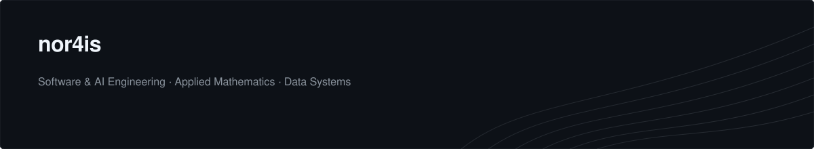

  

 

### About Me

I am a software and AI engineer with a background in mathematics and computer science. My work centers on turning complex data into reliable, practical software—ranging from statistical modeling and data analytics pipelines to production applications built around Large Language Models (LLMs).

I value clean system design, readable code, and maintainable engineering over unnecessary complexity. Whether I am designing a backend service, structuring a data workflow, or integrating language models into real-world products, my focus is always on building tools that solve actual problems predictably and well.

 

---

 

### Core Skills

- **Languages:** Python, TypeScript, SQL, Go, C++
- **AI & Machine Learning:** Large Language Models (LLMs), Retrieval-Augmented Generation (RAG), PyTorch, scikit-learn, Hugging Face, Prompt & Evaluation Pipelines
- **Data & Analytics:** Pandas, NumPy, Apache Spark, PostgreSQL, Vector Databases (pgvector, Qdrant), Data Modeling & ETL
- **Backend & Web:** FastAPI, Node.js, REST & GraphQL APIs, Redis, Docker
- **Cloud & Tooling:** AWS, GCP, Linux, Git, CI/CD (GitHub Actions)

 

---

 

### Featured Work

- **Document Intelligence & RAG Pipeline**  
  An end-to-end retrieval and question-answering service that indexes technical documents and delivers grounded, source-cited responses using LLMs.

- **Automated Data Quality & Analytics Engine**  
  A modular Python framework designed to validate, clean, and summarize large tabular datasets before they reach downstream reporting and predictive models.

- **LLM Evaluation & Benchmarking Suite**  
  A lightweight toolkit for testing prompt consistency, response latency, and output accuracy across different language model providers.
