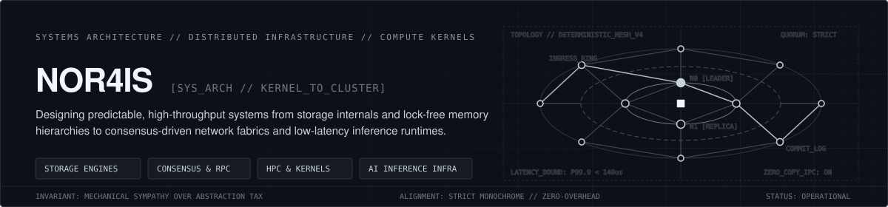

<div align="center">
  
</div>

<br />

```text
ID          :: nor4is
DISCIPLINE  :: Systems Architecture, Distributed Storage, High-Performance Compute, Applied Formal Methods
PHILOSOPHY  :: Mechanical sympathy, bounded tail latency, explicit state machines, zero-cost abstractions
```

---

### 01 // ARCHITECTURAL THESIS

Software systems fail at the boundaries where abstractions hide physical reality. When you treat the network as reliable, memory as flat, disk I/O as synchronous, or concurrency as free, the system eventually pays for that illusion in p99.9 tail-latency spikes and cascading state corruption.

My work focuses on building infrastructure where the execution path is explicit from the user-space API down to the hardware interface. Whether designing a log-structured storage engine, tuning a kernel-bypass RPC fabric, or scheduling quantized tensor operations across heterogeneous accelerators, the governing rule remains constant: **understand the underlying machine, bound every queue, verify state transitions deterministically, and keep the operational surface area ruthlessly small.**

> "Simplicity is not the absence of complexity; it is the discipline of confining complexity to deterministic, testable boundaries."

---

### 02 // ACTIVE DOMAINS & SYSTEM TAXONOMY

The following taxonomy maps the core engineering domains, algorithmic primitives, and runtime layers across which I architect and benchmark systems.

```text
SYSTEM_TAXONOMY_ROOT
│
├── [01] STORAGE ENGINES & DATABASE INTERNALS
│   ├── Access Methods       :: LSM-Trees (Leveled / Tiered Compaction), B+Trees, Bw-Trees, WISCKey (Key-Value Separation)
│   ├── Durability & WAL     :: Group Commit Pipelines, Direct I/O (O_DIRECT), CRC32C / xxHash64 Checksumming, ARIES Recovery
│   ├── Concurrency Control  :: Multi-Version Concurrency Control (MVCC), Optimistic Lock Coupling, Serializable Snapshot Isolation (SSI)
│   ├── Buffer Management    :: Clock-Sweep & 2Q Eviction, Pointer Swizzling, HugeTLB Arena Allocators, Zero-Copy Page Pinning
│   └── Query Execution      :: Vectorized Volcano / Push-Based Engines, SIMD Predicate Evaluation, Late Materialization, LLVM JIT
│
├── [02] HIGH-PERFORMANCE COMPUTING & MECHANICAL SYMPATHY
│   ├── Memory Hierarchy     :: Cache-Oblivious Layouts, False-Sharing Elimination, NUMA-Aware Thread Pinning, Custom Slab/Arena Allocators
│   ├── Lock-Free Primitives :: Wait-Free SPSC/MPMC Ring Buffers, Hazard Pointers, Epoch-Based Reclamation (EBR), Seqlocks
│   ├── Vectorization & ISA  :: Explicit AVX-512 / NEON Intrinsics, Structure-of-Arrays (SoA) Data Transforms, Branchless Bit-Manipulation
│   └── Asynchronous I/O     :: Linux io_uring (SQPOLL / Registered Buffers), epoll Edge-Triggered Loops, Userspace Cooperative Schedulers
│
├── [03] DISTRIBUTED NETWORK FABRICS & CONSENSUS
│   ├── State Machine Repl.  :: Raft (Pre-Vote, Leadership Transfer, Joint Consensus), Multi-Paxos, Flexible Quorum Topologies
│   ├── Dataplane & Kernel   :: eBPF / XDP Packet Filtering, DPDK, RDMA (RoCEv2) Verbs, QUIC / HTTP3 Custom Congestion Controllers
│   ├── Cluster Membership   :: SWIM Gossip Dissemination, Phi Accrual Failure Detectors, Consistent Hashing with Bounded Loads
│   └── Distributed State    :: Hybrid Logical Clocks (HLC), Conflict-Free Replicated Data Types (Delta-State CRDTs), 2PC over Consensus
│
├── [04] MATHEMATICAL MODELING & FORMAL VERIFICATION
│   ├── Specification        :: TLA+ / PlusCal Temporal Logic, Alloy Relational Modeling, Property-Based Stateful Fuzzing
│   ├── Deterministic Sim.   :: Single-Seeded Simulated Network/Disk Fault Injection (Jepsen-Style Nemesis Testing in User-Space)
│   ├── Probabilistic Struct :: Count-Min Sketches, HyperLogLog++, Ribbon Filters, Xor Filters, T-Digests for Streaming Quantiles
│   └── Optimization         :: Convex Optimization, Queuing Theory (Little's Law / M/M/c/K Backpressure Models), Graph Partitioning
│
└── [05] PRODUCTION-SCALE AI & INFERENCE INFRASTRUCTURE
    ├── Serving Runtimes     :: Continuous Iteration-Level Batching, PagedAttention KV-Cache Managers, Speculative Decoding Pipelines
    ├── Kernel Engineering   :: Custom CUDA / Triton Fused Kernels, FlashAttention Memory Tiling, INT4/FP8 Mixed-Precision Quantization
    ├── Vector Retrieval     :: DiskANN (Vamana Graphs), HNSW with Product Quantization (PQ), Inverted File Flat (IVF) GPU Indexing
    └── Distributed Training :: Ring/Tree AllReduce Collectives, Tensor/Pipeline Parallelism, Zero-Redundancy Optimizer (ZeRO) Sharding
```

---

### 03 // SYSTEM EXECUTION TOPOLOGY

Every high-throughput data-intensive service I design adheres to a strict separation between the **Control Plane** (consensus, topology placement, schema catalogs) and the **Data Plane** (shared-nothing, thread-per-core execution with zero cross-core lock contention).

```text
+-------------------------------------------------------------------------------------------------------+
|                                     INGRESS & EDGE DATAPLANE                                          |
|   [ eBPF / XDP L4 Filter ]  --->  [ Zero-Copy TLS / QUIC Termination ]  --->  [ Adaptive Load Shed ]  |
+-------------------------------------------------------------------------------------------------------+
                                                    |
                                     Lock-Free SPSC Sharded Dispatch
                                                    v
+-------------------------------------------------------------------------------------------------------+
|                             SHARED-NOTHING THREAD-PER-CORE RUNTIME                                    |
|                                                                                                       |
|   +-------------------------------+   +-------------------------------+   +-----------------------+   |
|   | CORE 0 // SHARD_A             |   | CORE 1 // SHARD_B             |   | CORE N // SHARD_K     |   |
|   | - Pinned NUMA Memory Arena    |   | - Pinned NUMA Memory Arena    |   | - Pinned NUMA Arena   |   |
|   | - Local Raft State Machine    |   | - Local Raft State Machine    |   | - Local State Machine |   |
|   | - Vectorized MemTable + Cache |   | - Vectorized MemTable + Cache |   | - Vectorized MemTable |   |
|   | - Dedicated io_uring Ring     |   | - Dedicated io_uring Ring     |   | - Dedicated io_uring  |   |
|   +-------------------------------+   +-------------------------------+   +-----------------------+   |
+-------------------------------------------------------------------------------------------------------+
                                                    |
                                  O_DIRECT / NVMe Polling / Group WAL
                                                    v
+-------------------------------------------------------------------------------------------------------+
|                                  DETERMINISTIC STORAGE SUBSYSTEM                                      |
|   [ Segmented Append-Only WAL ]  +  [ Tiered SSTable Compaction ]  +  [ Ribbon Filter Block Index ]   |
+-------------------------------------------------------------------------------------------------------+
```

---

### 04 // FEATURED SYSTEMS & ARCHITECTURAL INITIATIVES

A curated matrix of production architecture blueprints, systems research implementations, and infrastructure engines spanning systems languages and low-level runtimes.

| System / Blueprint | Primary Domain | Core Stack & Primitives | Architectural Invariants & Design Highlights | Target Operational Profile |
| :--- | :--- | :--- | :--- | :--- |
| **`aether-kv`** | Distributed Transactional Storage Engine | `Rust` `io_uring` `Raft` `SIMD` | Shared-nothing thread-per-core LSM storage engine. Implements WISCKey value separation, Ribbon filters (`30%` lower memory than Bloom), and group-commit WAL over registered NVMe buffers. | `1.4M+` read IOPS/node; `p99.9 < 1.8ms` under mixed YCSB-A workload |
| **`chronos-consensus`** | Deterministic Consensus & Simulation Harness | `Rust` `TLA+` `Deterministic-IO` | Multi-group Raft engine built entirely on an abstract time and network trait. Validated via single-threaded deterministic simulation with injected split-brains, packet reordering, and torn writes. | Zero linearizability violations across `10^7` simulated fault cycles |
| **`velox-ipc`** | Ultra-Low-Latency Shared-Memory Transport | `C++23` `x86 Intrinsics` `HugeTLB` | Wait-free multi-producer multi-consumer (MPMC) ring buffer fabric utilizing `2MB`/`1GB` hugepages, cache-line padding, and epoch-based memory reclamation for zero-allocation inter-process messaging. | `110ns` median end-to-end IPC latency; `45M+` messages/sec per channel |
| **`tensor-forge`** | LLM Inference & KV-Cache Scheduling Runtime | `C++20` `CUDA` `Triton` `Rust` | High-density serving runtime featuring paged KV-cache block allocation, continuous iteration-level batching, and custom fused FP8/INT4 dequantization-GEMM kernels. | `3.2x` token throughput over naive static batching; `< 18ms` inter-token latency |
| **`ann-strata`** | Disk-Resident Billion-Scale Vector Index | `Rust` `C++` `AVX-512` `mmap` | Hybrid RAM/NVMe graph-based approximate nearest neighbor engine inspired by DiskANN. Combines in-memory Product Quantization (PQ) routing with single-hop `io_uring` disk reads for full-precision vectors. | Sub-`4ms` p95 recall@10 (`>0.95`) on `100M` 768-d vectors within `16GB` RAM |
| **`spectre-ebpf`** | Kernel-Level Telemetry & L7 Flow Control | `C` `eBPF / XDP` `Go` `Protobuf` | Zero-instrumentation observability agent attaching to kernel tracepoints, socket buffers, and XDP hooks. Extracts sub-millisecond TCP RTT, syscall latency histograms, and dynamic rate-limiting at line rate. | `< 1.2%` CPU overhead at `40Gbps` ingress packet rates |
| **`columnar-jit`** | Embedded Vectorized OLAP Execution Engine | `C++23` `Apache Arrow` `LLVM JIT` | Push-based analytical execution engine operating directly on Arrow columnar batches. Compiles filter-project-aggregate pipelines into native machine code with SIMD late materialization. | `18 GB/s` per-core scan throughput on dictionary-encoded parquet streams |
| **`quorum-mesh`** | Gossip-Driven Overlay & Service Fabric | `Go` `QUIC` `FlatBuffers` `CRDT` | Decentralized cluster control plane combining SWIM membership protocols with delta-state CRDT routing tables and zero-RTT multiplexed QUIC streams across multi-region topologies. | Sub-second cluster convergence across `2,000+` ephemeral nodes |

---

### 05 // TECHNICAL STACK & TOOLING MATRIX

| Layer | Technologies, Languages & Specifications |
| :--- | :--- |
| **Systems & Kernel Languages** | `Rust (Async / No-Std / Unsafe Internals)` · `Modern C++ (C++20 / C++23)` · `C (C11 / Kernel / eBPF)` · `Go` · `Zig` · `x86_64 Assembly` |
| **Parallel Compute & AI Systems** | `CUDA C++` · `OpenAI Triton` · `PyTorch C++ Extension (LibTorch)` · `ONNX Runtime` · `AVX-512 / ARM NEON SIMD` · `OpenMP` · `MPI` |
| **Storage & Data Architecture** | `RocksDB / TiKV Internals` · `PostgreSQL Internals` · `ClickHouse` · `Apache Arrow / Parquet` · `DuckDB` · `FoundationDB` · `Redpanda / Kafka` |
| **Networking & Protocols** | `Linux io_uring` · `eBPF / XDP` · `QUIC / HTTP3` · `gRPC / Protobuf` · `FlatBuffers` · `Cap'n Proto` · `RDMA / RoCEv2` · `TCP/IP Stack Tuning` |
| **Verification & Observability** | `TLA+ / PlusCal` · `Jepsen / Deterministic Simulation` · `perf` · `FlameGraphs` · `bpftrace` · `Valgrind / Cachegrind` · `Sanitizers (ASan, TSan, MSan)` |
| **Infrastructure & Orchestration** | `Linux Kernel (6.x)` · `Nix / NixOS` · `Kubernetes (Custom Controllers / CNI)` · `Terraform` · `Prometheus` · `OpenTelemetry` |

---

### 06 // ENGINEERING PRINCIPLES & INVARIANTS

1. **Backpressure is Mandatory:** Unbounded queues are latent out-of-memory crashes waiting for a traffic spike. Every queue, channel, and buffer pool must have a hard capacity limit and an explicit rejection or shedding policy.
2. **Design for the Cache Hierarchy:** A pointer chase across L3 cache and main memory costs two orders of magnitude more than an ALU instruction. Prefer contiguous arrays, cache-aligned structs, and data-oriented design over deep object graphs.
3. **Deterministic Testing Over Hope:** Concurrency bugs do not surface in happy-path unit tests. Abstract clocks, disk I/O, and network sockets behind deterministic interfaces so distributed state machines can be simulated across millions of seeded fault permutations.
4. **Tail Latency Defines System Quality:** Median latency is a vanity metric. In fan-out distributed architectures, a single slow shard dictates the response time of the entire request tree. Optimize relentlessly for `p99.9` and `p99.99`.
5. **Operational Clarity:** Any production system must expose its internal state—queue depths, compaction debt, cache hit ratios, and lock contention—through low-overhead structured telemetry without requiring a debugger attachment.

---

### 07 // TELEMETRY & ACTIVITY

<div align="center">
  
</div>

<br />

<div align="center">
  
</div>

<br />

```text
---------------------------------------------------------------------------------------------------------
EOF // NOR4IS // ARCHITECTURAL PORTFOLIO // DETERMINISTIC SYSTEMS & INFRASTRUCTURE
---------------------------------------------------------------------------------------------------------
```
